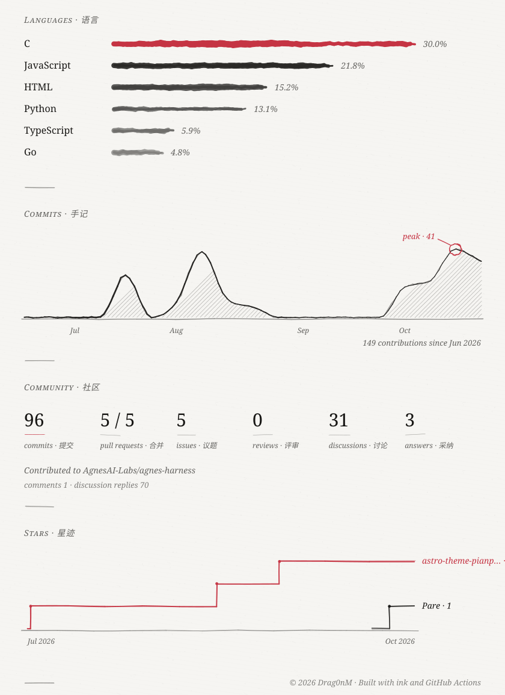

<picture>
  <source media="(prefers-color-scheme: dark)" srcset="assets/header-dark.svg">
  
</picture>

<!-- works:start -->

<a href="https://github.com/DRAG0NM/astro-theme-interleaf"><picture>
  <source media="(prefers-color-scheme: dark)" srcset="assets/work-1-dark.svg">
  
</picture></a> 
<a href="https://github.com/DRAG0NM/heartwork"><picture>
  <source media="(prefers-color-scheme: dark)" srcset="assets/work-2-dark.svg">
  
</picture></a> 
<a href="https://github.com/DRAG0NM/AutoTune-Bot"><picture>
  <source media="(prefers-color-scheme: dark)" srcset="assets/work-3-dark.svg">
  
</picture></a> 
<a href="https://github.com/DRAG0NM/Pare"><picture>
  <source media="(prefers-color-scheme: dark)" srcset="assets/work-4-dark.svg">
  
</picture></a> 
<a href="https://drablog.pages.dev/"><picture>
  <source media="(prefers-color-scheme: dark)" srcset="assets/work-5-dark.svg">
  
</picture></a> 

<!-- works:end -->

<picture>
  <source media="(prefers-color-scheme: dark)" srcset="assets/stats-dark.svg">
  
</picture>
