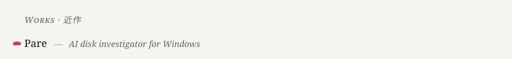
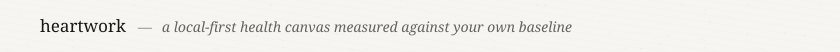
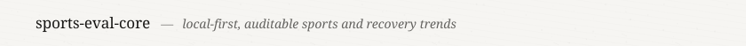
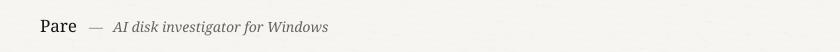
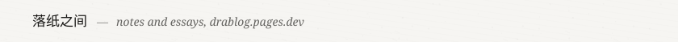
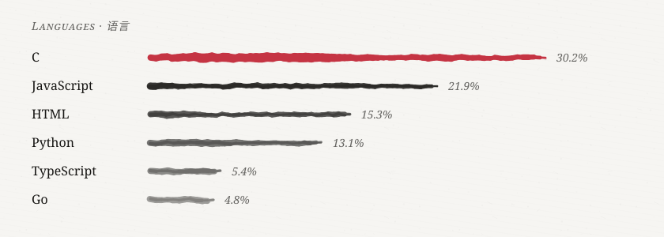
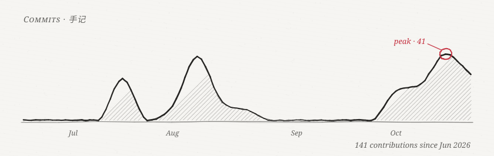
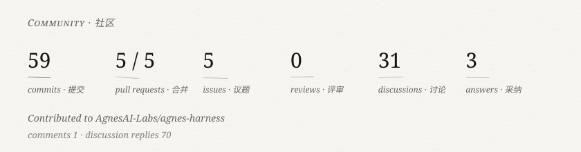
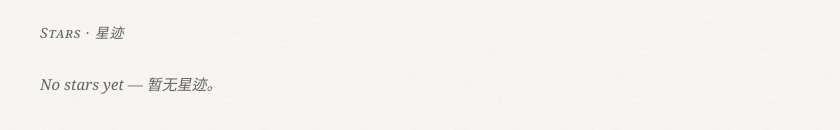
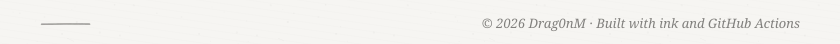

<picture>
  <source media="(prefers-color-scheme: dark)" srcset="assets/header-dark.svg">
  
</picture>

<a href="https://github.com/DRAG0NM/Pare"><picture>
  <source media="(prefers-color-scheme: dark)" srcset="assets/work-1-dark.svg">
  
</picture></a> 
<a href="https://github.com/DRAG0NM/astro-theme-pianpker"><picture>
  <source media="(prefers-color-scheme: dark)" srcset="assets/work-2-dark.svg">
  
</picture></a> 
<a href="https://github.com/DRAG0NM/sports-eval-core"><picture>
  <source media="(prefers-color-scheme: dark)" srcset="assets/work-3-dark.svg">
  
</picture></a> 
<a href="https://github.com/DRAG0NM/AutoTune-Bot"><picture>
  <source media="(prefers-color-scheme: dark)" srcset="assets/work-4-dark.svg">
  
</picture></a> 
<a href="https://drablog.pages.dev/"><picture>
  <source media="(prefers-color-scheme: dark)" srcset="assets/work-5-dark.svg">
  
</picture></a> 

<picture>
  <source media="(prefers-color-scheme: dark)" srcset="assets/languages-dark.svg">
  
</picture>

<picture>
  <source media="(prefers-color-scheme: dark)" srcset="assets/commits-dark.svg">
  
</picture>

<picture>
  <source media="(prefers-color-scheme: dark)" srcset="assets/community-dark.svg">
  
</picture>

<picture>
  <source media="(prefers-color-scheme: dark)" srcset="assets/stars-dark.svg">
  
</picture>

<picture>
  <source media="(prefers-color-scheme: dark)" srcset="assets/footer-dark.svg">
  
</picture>
